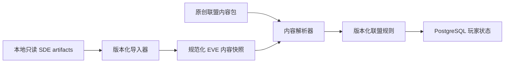

# EVE SDE 内容接入规划

## 本地来源

当前只读参考目录为 `reference/sde/`，包含：

- `eve-online-static-data-3448696-jsonl.zip`；
- `sde_sqlite.db`；
- `latest-postgres.pgdump`。

JSONL 元数据确认 build 为 `3448696`，发布日期为 `2026-07-28T11:07:17Z`。这些大文件是本地输入，
不应提交到 Git，也不应直接挂载为生产运行时数据库。

`sde_guide.md` 解释了传统 SDE 表的用途；实现时以本地实际 artifact 和导入契约为准，因为转换版本的
表名、字段和本地化元数据可能不同。

## 已确认的数据能力

| 领域 | 当前 build 中的证据 | Alpha 用途 |
|---|---|---|
| 类型目录 | 52,822 `invTypes`，带分类、分组、市场组、meta 和发布状态 | 舰船、模块、技能、材料、商品的稳定 EVE 身份 |
| Dogma/特性 | 645,744 类型属性、54,071 类型效果、3,562 traits | 选择性提取装配、槽位、需求和可解释特性 |
| 工业 | 19,137 blueprint activity，材料、产品、技能与时间表 | 生产配方和 EVE 原始要求 |
| 空间 | 114 区域、1,184 星座、8,490 星系、13,978 星系跳转 | high/low/null 地图、路线和星门访问 |
| 能力 | certificates、masteries、ship skills 和技能类型 | EVE 技能计划、舰船能力和专精参考 |
| 内容参考 | missions、epic arcs、dungeons、agents、NPC corporations | 研究 EVE 内容结构；不直接等同于联盟原创任务 |
| i18n | JSONL 名称/描述内嵌 8 种语言：de/en/es/fr/ja/ko/ru/zh | Discord、Telegram 与未来 Web 的本地化显示 |

SQLite 的 `trnTranslations` 有大量翻译记录，但本 build 的部分 translation metadata 表为空。JSONL
已经把本地化文本嵌入对应记录，因此 Alpha 导入以 JSONL 为首选权威输入；SQLite 用于探索、交叉
统计和导入验证，PostgreSQL dump 仅供离线分析，不导入玩家数据库的 `public` schema。

## 数据分层

五层含义不能混用：

1. **Raw artifact**：CCP/转换器提供的原始数据；只读、可替换。
2. **EVE snapshot**：导入器选择并规范化的 EVE 事实，带来源和 build。
3. **Authored content**：本游戏的事件链、任务、知识技能、政策和叙事文本。
4. **Rules**：用户确认的联盟公式和数值版本。
5. **Runtime state**：联盟成员、资产、行动、事件、订单、钱包与解锁。

玩家存档只引用稳定内容 ID 和必要快照，不持有指向本地 SQLite 文件的外键。

## 稳定 ID 与来源

建议使用带命名空间的内容 ID：

- `eve:type:587`；
- `eve:system:30000001`；
- `eve:blueprint:681`；
- `asim:knowledge:fitting-theory`；
- `asim:event:tutorial-first-doctrine`。

每个导入快照至少记录：

- `sde_build_number` 与 `release_date`；
- 输入 artifact 的加密摘要；
- `importer_version` 与 projection schema version；
- 导入时间和通过的验证集合；
- 每类投影的记录数。

同一 SDE 数字 ID 在 build 间保持身份时，命名空间 ID 不变；显示文本和属性随内容 build 变化。被
删除或 unpublished 的类型不能重新分配给原创内容，也不能让既有存档失去解释。

## 首批投影

### Catalog

- types、groups、categories、market groups、meta groups；
- published、体积、容量、质量、基础价格等原始字段；
- 所有可用 locale 的名称和描述。

### Map

- regions、constellations、solar systems、security status/class；
- stargates 与有向/无向跳转关系；
- Alpha 需要的 NPC faction 关联。

星门是否被联盟“解锁”属于运行时 RouteAccess，不应删除或改写 SDE 地图边。

### Skills and capability

- EVE skill 类型、ship skill requirements；
- certificates、masteries 及其技能要求；
- traits 中与舰船/技能相关的可显示信息。

原创 KnowledgeSkill 只可引用 EVE 内容作为上下文，不能占用 EVE type ID。

### Industry and fitting

- blueprint activities、materials、products、required skills 和原始 time；
- 类型材料、体积、meta parent；
- 经 allowlist 明确选择的 Dogma attributes/effects。

Alpha 不实现通用 Dogma 表达式解释器。每个用于结算的属性必须有明确语义、单位、测试和不支持时的
失败方式；未知属性不能默认为零。

### Narrative references

missions、epic arcs、dungeons、agents 和 NPC corporation 可以帮助理解 EVE 内容关系，但不会被
自动转换为可玩的联盟事件。教学链和联盟事件必须有自己的内容 ID、选择、效果、版本与产品审查。

## i18n 规则

- 内容存储保留 locale map，不在导入时只留下单一语言；
- 展示时按 `请求 locale → en → 稳定 ID` 回退；
- 原创内容与 SDE 内容使用相同 locale 接口，但保留不同来源；
- 搜索索引可以按 locale 单独构建，结算逻辑永远使用 ID，不使用翻译文本；
- 缺失翻译应成为导入报告，不阻塞与语言无关的领域结算。

## 更新流程

1. 把新 artifact 放入本地只读参考目录，不覆盖旧 build 的审计信息。
2. 在隔离的 Docker 任务中生成候选 projection 和差异报告。
3. 报告新增、删除、unpublished、属性变化、地图变化和缺失翻译。
4. 用户确认会改变玩法或内容可用性的差异；工程确认 schema 与兼容性。
5. 生成不可变内容快照，运行引用完整性、数量、单位、路线和 i18n 检查。
6. 部署新内容版本；运行中行动和既有事件继续使用开始时冻结的版本/快照。

SDE build 升级不是普通应用启动步骤，不能在 Bot 启动时隐式执行。

## 外部动态数据边界

SDE 是静态数据，不包含 Tranquility 的实时市场价格、库存、玩家联盟或实时主权。Alpha 的“全局
物价”必须单独选择：

- 受控原创市场模拟；
- ESI/可信第三方行情快照；
- 外部基准加原创扰动的混合模式。

选择、缓存、失效、停服降级和法律/数据政策属于 α5 的独立策划与架构决策，不能用 `basePrice`
冒充实时市场价格。

## 发布与知识产权检查

使用 SDE 不等于自动获得对所有名称、文本、图标和衍生数据的无限再发布权。公开发布前必须确认
CCP 的当前开发者条款、商标与粉丝内容政策，记录来源和必要声明，并决定哪些原始文本/图像可以随
产品分发。此检查不阻止本地策划和导入实验，但它是任何公开 Alpha 的发布门槛。
