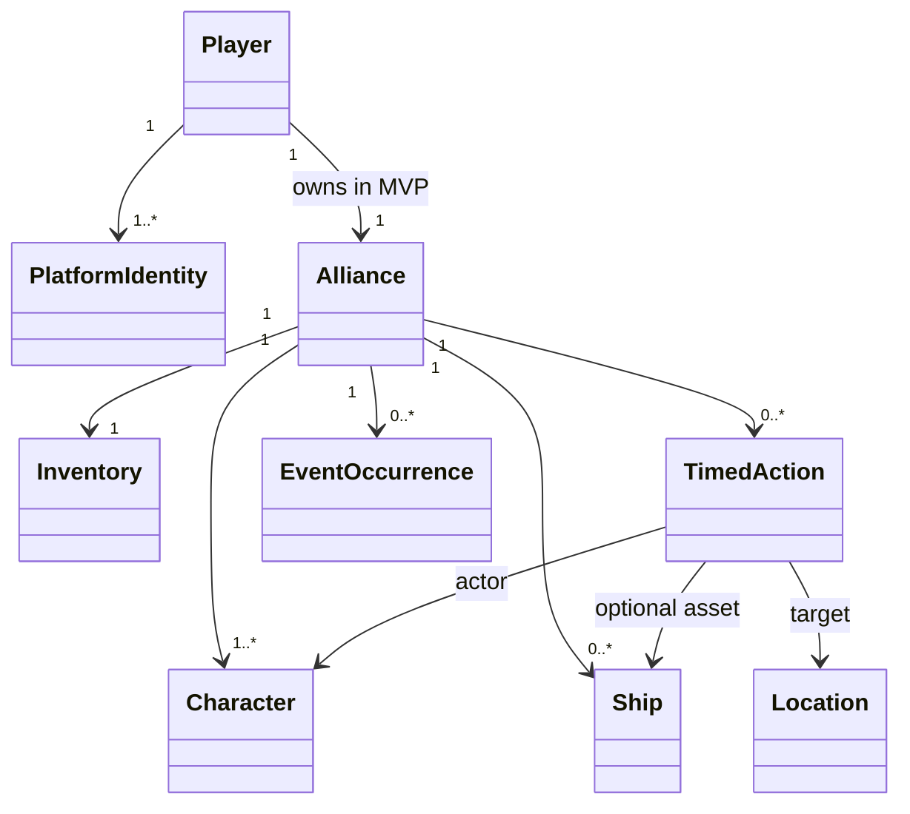
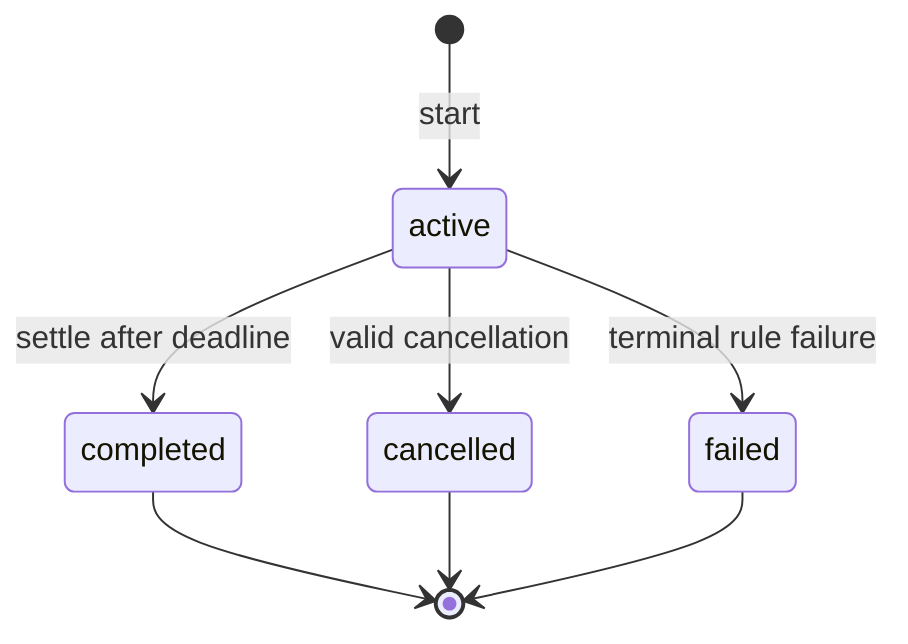

# 领域模型

本文件描述 MVP 的统一语言，不等同于数据库表设计。实现应优先表达这些含义，而不是机械复制旧项目类名。

## 核心概念

| 概念 | 含义 |
|---|---|
| Player | 真实玩家在游戏中的内部身份，与聊天平台账号分离 |
| PlatformIdentity | Discord 或 Telegram 账号与 Player 的绑定 |
| Alliance | 玩家控制的主要聚合，拥有成员、资产、库存和进行中行动 |
| Character | 联盟中的模拟成员，具备技能与可执行行动能力 |
| Ship | 联盟资产；某些行动要求特定舰船或模块 |
| Inventory | 按材料 ID 记录的联盟资源数量 |
| Location | 行动发生的逻辑地点，而非实时三维坐标 |
| TimedAction | 有开始和完成时间的持久化行动，如采矿或训练 |
| EventOccurrence | 已经对某联盟发生、等待选择或已经解决的事件实例 |
| ContentDefinition | 材料、舰船、技能和事件模板等版本化静态定义 |

## 关系

## 应用命令

首批命令采用明确动词，不让平台命令字符串进入领域层：

- `CreateAlliance(player_id, name, idempotency_key)`
- `GetAllianceStatus(player_id)`
- `StartMining(alliance_id, character_id, ship_id, location_id, idempotency_key)`
- `CompleteTimedAction(action_id)`
- `ListPendingEvents(alliance_id)`
- `ResolveEvent(alliance_id, occurrence_id, option_id, idempotency_key)`

查询不得偷偷改变游戏状态；逾期行动由 Worker 或显式协调器结算，不在展示代码中临时修改对象。

## 采矿规则基线

M1 只需要足够完成闭环的规则：

1. 联盟、角色、舰船和地点必须存在且属于正确范围。
2. 角色和舰船在同一时刻最多参与一个互斥行动。
3. 开始行动时确定持续时间，并记录规则/内容版本。
4. 完成时只结算一次，将整数数量的材料加入联盟库存。
5. 完成事务同时创建通知发件箱记录。
6. 重复执行完成命令返回既有结果，不再次发放资源。

## TimedAction 状态

Worker 的认领、租约和重试次数属于基础设施状态，不应混入上述玩家可见状态。

## EventOccurrence 状态

- `pending`：已经发生并等待玩家选择；
- `resolved`：某个选项已成功应用；
- `expired`：超过期限并执行了默认结果；
- `cancelled`：因明确的游戏规则失效。

事件模板是静态内容，事件实例保存触发时需要冻结的数据。选项解析必须校验实例仍属于目标联盟且处于 `pending`。

## 领域事件与通知

领域事件描述已经发生的事实，例如 `MiningCompleted`、`MaterialAdded`、`AllianceEventTriggered`。它们可用于创建通知或后续事件，但不能等同于 Discord 消息。通知投递失败不会回滚已经成功的游戏结算。
