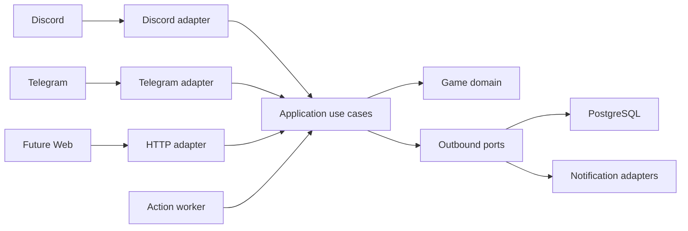

# 总体架构

## 架构风格

项目采用模块化单体和端口—适配器架构。MVP 的入口与后台任务作为可独立启动的进程运行，
但共享同一代码库和 PostgreSQL：

- **API 进程**：提供存活、就绪检查和未来 HTTP 接口；
- **Discord 进程**：接收 slash command 与 component interaction；
- **Telegram 进程**：接收 command 与 inline keyboard callback；
- **Worker 进程**：认领到期行动、执行结算并发送通知。

这些进程可以部署在同一主机上，入口之间不通过网络互调。初期不拆微服务；清晰的模块边界
用于控制耦合，而不是增加网络调用。

MVP 使用一个锁定依赖的应用镜像承载上述进程。Docker Compose 先等待 PostgreSQL 健康并在独立
容器中执行迁移，再启动 API、Worker 和所选平台入口；Telegram 与 Discord 通过 profile 按需启用。
质量检查使用单独的镜像阶段和临时 PostgreSQL，不接触玩家存档数据库。



## 依赖规则

依赖只能向内：

1. `domain` 只包含规则、值对象和状态转换，不导入数据库、框架或平台 SDK。
2. `application` 编排用例、事务和端口，不包含平台展示细节。
3. `adapters` 将平台输入转换为应用命令，并实现数据库、通知等端口。
4. `bootstrap` 负责配置、依赖组装和进程入口。

## 目标目录结构

```text
src/alliancesim/
  domain/                 # 实体、值对象、领域服务、领域事件
  application/            # 用例、命令、查询、端口、事务边界
  adapters/
    inbound/
      discord/
      telegram/
      http/
    outbound/
      persistence/
      notifications/
  bootstrap/              # 设置、依赖注入和进程入口
content/                  # 版本化的舰船、材料、事件等静态定义
migrations/               # Alembic 数据库迁移
tests/
  unit/
  integration/
  contract/
  e2e/
docs/
```

## 推荐技术基线

- Python 3.13 或更新的兼容版本；
- `uv` 管理环境、锁文件和命令；
- Pydantic 负责边界数据验证；
- SQLAlchemy 2 和 Alembic 负责持久化；
- PostgreSQL 是唯一权威状态源；
- discord.py 和 aiogram 实现平台适配器；
- FastAPI 为健康检查、管理接口及未来 Web API 提供入口；
- pytest、Hypothesis、Ruff 和 Pyright 作为质量门槛。

具体版本在 M0 创建锁文件时固定；文档不记录容易过期的补丁版本。

## 数据与事务

- 所有时间使用 UTC；仅在展示层转换时区。
- 运行时实体使用 UUID；静态内容使用可读且稳定的字符串 ID。
- 资源数量使用整数；需要小数时使用 `Decimal`，不使用二进制浮点表示经济数值。
- 每个改变状态的用例拥有明确事务边界。
- 平台交互 ID 作为幂等键，防止回调或网络重试造成重复结算。
- 状态更新与通知发件箱记录在同一个事务中提交。

## 时间行动

采矿和训练保存为拥有 `started_at`、`finishes_at` 和状态的记录。Worker 以数据库锁认领到期行动，领域逻辑根据记录结算。进程重启后继续扫描，因此不依赖内存任务存活。

MVP 不引入 Redis 或 Celery。只有在 PostgreSQL 方案经过测量成为瓶颈后，才考虑独立队列系统。

## 平台输出

应用层返回平台无关的展示模型，例如标题、正文、字段和可用动作。平台适配器负责转换为 Discord component、Telegram inline keyboard 或 HTTP JSON。领域对象不能直接生成 Markdown 或平台按钮。

## 运行与可观测性

- 配置来自环境变量，密钥不进入仓库。
- 日志采用结构化输出；平台请求携带 `request_id`，后台结算和通知分别携带
  `action_id`、`outbox_id`。存在内部玩家上下文时使用 `player_id`，不使用显示名作为关联键。
- 至少提供存活和就绪检查。
- Worker 记录任务延迟、成功、重试和最终失败。
- 数据库迁移必须可在部署时单独执行。
