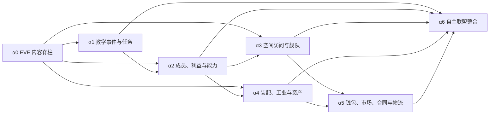

# Alpha 路线图

## Alpha 定义

MVP 证明“一个联盟、一个行动、一次事件”可以可靠运行。Alpha 要证明多个联盟系统能够形成持续的
经营压力：成员有能力和诉求，舰队需要角色协作，空间开放带来风险，工业和市场改变资产获取方式，
联盟可以在玩家授权下自行组织部分活动。

Alpha 不以命令数量或 SDE 导入记录数作为成功标准。每个里程碑必须增加一条玩家可观察的决策闭环，
并使用用户确认的规则版本；`test-fast` 数值只能用于自动化。

## 顺序与依赖

α3 与 α4 在 α2 完成后可以并行策划，但实现仍应保持小而完整的提交。α6 是整合和内容里程碑，
不是把前面遗漏的基础设施集中补齐。

## 里程碑总览

| 里程碑 | 玩家可观察结果 | 主要策划门槛 |
|---|---|---|
| α0：EVE 内容脊柱 | 游戏能用玩家 locale 稳定展示真实 EVE 类型、技能、蓝图和星系关系 | 决定首批允许出现的内容范围，不决定联盟平衡 |
| α1：教学事件与任务 | 新联盟沿教学链做出选择，解锁第一组可重复任务与后续章节 | GD-002、GD-008 |
| α2：成员、利益与能力 | 联盟拥有匿名群体、具名骨干、诉求和技能计划；计划与实际执行可比较 | GD-001–GD-007 |
| α3：空间访问与舰队 | 玩家通过进程开放 low/null 路线，并用矿船、护航和 FC 组成协作舰队 | GD-009–GD-011 |
| α4：装配、工业与资产 | 装配成熟度可解释，联盟能沿 SDE 蓝图产业链制造并分配舰船/物品 | GD-012–GD-013 |
| α5：钱包、市场、合同与物流 | 联盟能预算、买卖、统一收购、签合同并让物流服务跨星系履约 | GD-014–GD-017 |
| α6：自主联盟整合 | 具名 FC/骨干在授权内组织活动，利益、经济和事件共同产生长期联盟故事 | GD-018 及前述规则稳定版 |

## α0：EVE 内容脊柱

### 玩家结果

同一个 EVE 舰船、技能、蓝图或星系在 Discord、Telegram 和未来 Web 中拥有一致 ID，并按请求语言
显示。内容 build 可追溯，SDE 更新不会静默改变运行中行动。

### 范围

- JSONL SDE 导入器、内容 manifest、差异报告和 i18n；
- Catalog、Map、Skills/Certificates、Industry 和 allowlisted Dogma 投影；
- 内容查询端口与小型管理/诊断查询；
- 原创 `asim:` 与 SDE `eve:` 命名空间；
- 导入和更新的 Docker 工作流。

### 验收

1. 从本地 build `3448696` 可重复生成相同摘要的内容快照。
2. 类型、蓝图引用、星门目标、技能要求和 locale map 通过完整性检查。
3. 至少一艘舰船、一组模块、一项技能、一张蓝图和一条跨星系路线能被统一查询和展示。
4. 缺失/未知 Dogma 属性明确失败或跳过并进入报告，不以零参与结算。
5. 替换为构造的新 build 时产生可审阅差异，既有行动/事件兼容测试保持通过。

### 不包含

完整 Dogma 引擎、实时 ESI、全量图标分发或联盟平衡公式。

## α1：教学事件与任务

### 玩家结果

新联盟不再面对一组无上下文命令，而是沿教学章节认识成员、技能、舰队、工业和钱包。选择会留下
旗标或解锁，并开放可以重复完成的角色任务/任务链。

### 范围

- EventChain/TaskChain 图、前置条件、分支、延迟、失败和恢复；
- typed trigger/effect/unlock registry；
- 一套逐章节扩展的原创教学链；
- 一次性任务与可重复任务实例、冷却/并发规则接口；
- 玩家可查询“为何未解锁”和下一目标。

### 验收

1. 新联盟能完成首个教学章节并解锁至少一项可重复任务。
2. 分支、超时、重复 interaction 和 Bot 重启均不重复应用效果。
3. 旧内容版本创建的进行中链在内容更新后仍能继续或明确迁移。
4. 未满足前置条件时返回具体缺少的 Unlock/事实，不用隐藏布尔值。
5. 教学后续章节可以在 α2–α5 增量加入，无需重写链引擎。

### 不包含

在其他模块尚不存在时伪造完整舰队、工业或市场教学结果。

## α2：成员、利益与能力

### 玩家结果

玩家能看到联盟由哪些群体和具名成员组成、他们关心什么、正在学什么，以及技能计划为什么未按计划
执行。任命、培训、招募或调解会产生后续影响。

### 范围

- MemberCohort、NamedMember、InterestGroup、Role、Demand 和 Dispute；
- 加入、离开、具名化和角色任命事实；
- EVE Skill、KnowledgeSkill、SkillPlan 与 assignment；
- 计划步骤、实际训练事实、阻塞原因和可解释执行报告；
- 招募/流失策略接口与首个已确认规则集；
- 教学链的成员与技能章节。

### 验收

1. 同一联盟可以同时拥有匿名群体和具名骨干，二者总量变化可审计。
2. 利益群体和成员群体不会因实现方便被合并为同一概念。
3. 玩家能分配技能计划并看到完成、跳过、阻塞及原因；执行指标可由原始事实重算。
4. 至少一个原创 KnowledgeSkill 影响可解释建议或能力，但不冒充 EVE skill type。
5. 一项诉求可以被满足、拒绝或演变为纠纷，重复处理保持幂等。
6. 用户确认的 α2 tuning profile 有模拟报告和版本记录。

### 不包含

逐个模拟所有匿名成员的实时日程、完整社交网络或无约束生成式角色行为。

## α3：空间访问与舰队

### 玩家结果

联盟从有限的 high-sec 活动范围起步，通过事件/任务进程开放明确的 low-sec、null-sec 路线；玩家
可以组建包含矿船、护航和 FC 的舰队，使专门化协作优于每艘船自给自足。

### 范围

- SDE region/constellation/system/stargate 查询与路线规划；
- RouteAccess、地点能力、访问原因和解锁来源；
- Fleet、Doctrine、RoleRequirement、Assignment、FC 与 Operation；
- 采矿 + 护航的第一条多角色行动；
- 风险/损失策略接口和结算解释；
- 教学链的第一条空间开放章节。

### 验收

1. 路线只使用 SDE 中存在的星门边，访问规则不会改写客观拓扑。
2. 未开放路线说明缺少的事件、任务或能力；完成链后只授予一次访问。
3. Fleet 在开始时冻结成员、舰船、Doctrine、路线和规则版本。
4. 有/无合格护航的采矿行动在批准的规则下产生可解释差异。
5. FC 缺失、舰船冲突、成员忙碌和路线失效不会造成部分扣除或重复损失。
6. low/null 只开放经 Alpha 内容明确选中的小范围，不一次暴露全宇宙。

### 不包含

实时舰船操控、完整 PvP、主权战争或通用 Dogma 战斗模拟。

## α4：装配、工业与资产

### 玩家结果

玩家可以判断一套装配为何适合某项活动，发现能力或物资缺口，并使用真实 SDE 蓝图关系把材料转化
为舰船/模块。自产能降低长期获取压力，但需要产能、时间和技能投入。

### 范围

- Asset instance、Fit、ModuleSlot、Doctrine fit 和库存预留；
- allowlisted Dogma 装配约束与错误解释；
- 配装学/Doctrine 熟练等 KnowledgeSkill 的能力评估；
- Blueprint、ProductionOrder、Facility、Capacity 与生产结算；
- 材料、产品、技能和原始时间的 SDE 来源追踪；
- 制造、取消、失败和资产交付的事务边界。

### 验收

1. 一套装配能报告合法性、用途匹配、技能/知识缺口和材料可用性。
2. 未支持的 Dogma 语义不会被当成合法或数值零。
3. 生产开始时原子预留材料和产能，完成只生成一次资产。
4. 至少一条经用户选择的舰船或模块产业链从原料走到可分配资产。
5. SDE 更新后，运行中生产仍按冻结 blueprint/rules snapshot 结算。
6. 自产与外购的比较展示组成因素，不替用户自动选择最优策略。

### 不包含

全量 EVE 制造活动、通用发明/反应模拟或完整舰船伤害公式。

## α5：钱包、市场、合同与物流

### 玩家结果

联盟拥有可审计的钱包和预算，可以从全局市场获取物资、在内部发布合同、通过统一收购减少成员物资
滞留，并用物流服务把物资送到需要的星系。

### 范围

- Wallet、不可变 LedgerEntry、Budget 和授权；
- MarketQuote/Order/Trade 与选定的全局价格来源；
- 内部 Contract、物资/资金预留、履约、取消和过期；
- BuybackProgram 作为有版本的联盟政策/决议；
- Shipment、RoutePlan、运力、费用、风险和交付；
- 工业、舰队和物流对钱包/库存的统一结算。

### 验收

1. 任意余额可以从账本重建，重复回调不会重复记账。
2. 报价、下单和成交分离；成交保存当时价格，不被未来行情改写。
3. 内部合同不会双花资金或物资，取消/过期会可靠释放预留。
4. 统一收购只处理政策允许的类型、成员和预算，并能解释价格来源。
5. 物流使用已开放路线，占用运力和时间；交付、失败和取消均可审计。
6. 外部行情不可用时遵循批准的降级策略，不用 SDE `basePrice` 冒充实时价格。

### 不包含

与 Tranquility 玩家真实交易、支付系统、无监管自由交易或完整市场操纵模拟。

## α6：自主联盟整合

### 玩家结果

联盟开始表现为一个组织：具名 FC 或骨干观察成员能力、诉求和资源，在授权内提出或自动组织采矿、
任务、护航、生产或物流活动；玩家主要处理战略、例外和冲突，而不是逐个点击所有行动。

### 范围

- NamedMember 的 Authority、Proposal 和自动调度边界；
- 可重复活动模板、资源预算、冲突检测和玩家审批；
- 招募、留存、利益诉求、经济和行动结果的显式反馈；
- 多章节联盟事件、特殊具名群体/角色和可重复任务链；
- 一个覆盖 α1–α5 的原创 Alpha campaign；
- 可解释的周期报告与失败恢复。

### 验收

1. FC 能根据 Doctrine 和可用资源提出一项活动，玩家可批准、修改或拒绝。
2. 只有明确授权的低风险活动可以自动开始，预算、路线和资产约束仍完整校验。
3. 自动活动与手动活动使用同一应用用例、事务和幂等规则。
4. 成员诉求或纠纷能影响提案/参与，但每个结果都能追溯到规则和事实。
5. 招募与流失不会在状态查询时隐式发生，由定时结算产生可审计事实。
6. Alpha campaign 能从新联盟推进到一次 low/null 舰队、一次生产/合同/物流闭环和一个长期组织选择。
7. Discord 与 Telegram 产生等价领域结果；未来 Web 只需消费相同查询模型和命令。

### 不包含

无需玩家授权的无限自治、不可审计的 AI 决策或大规模多联盟 PvP。

## 每个 Alpha 里程碑的完成规则

- 阻塞该里程碑的 GD 决策已经由用户确认并版本化；
- 有一条平台无关的端到端玩家旅程和关键失败路径；
- Discord 与 Telegram 适配器不复制领域规则；
- 迁移可从空数据库和上一里程碑升级；
- 长期行动、事件、订单和合同在开始时冻结必要规则；
- 人工真实平台冒烟只验证平台边界，不替代自动化；
- 文档记录实际测试数据，不把诊断操作改写成理想结果；
- 完成后创建独立提交，未完成项不能靠手工改数据库伪造。

## 下一步策划工作坊

实现 α0 前只需要确认首批 EVE 内容范围；实现 α1 前必须先完成 GD-002 和 GD-008。建议下一轮按
以下顺序讨论，而不是同时为所有系统填数：

1. 教学链希望玩家学会的核心决策，以及允许犯的第一个错误；
2. Alpha 时间尺度与一次查看会话的目标长度；
3. 新联盟初始拥有哪些成员、资产、地点与限制；
4. 首个可重复任务的投入、风险、结果和解锁关系；
5. 完成上述闭环后，再进入成员群体与技能计划的详细模型。
