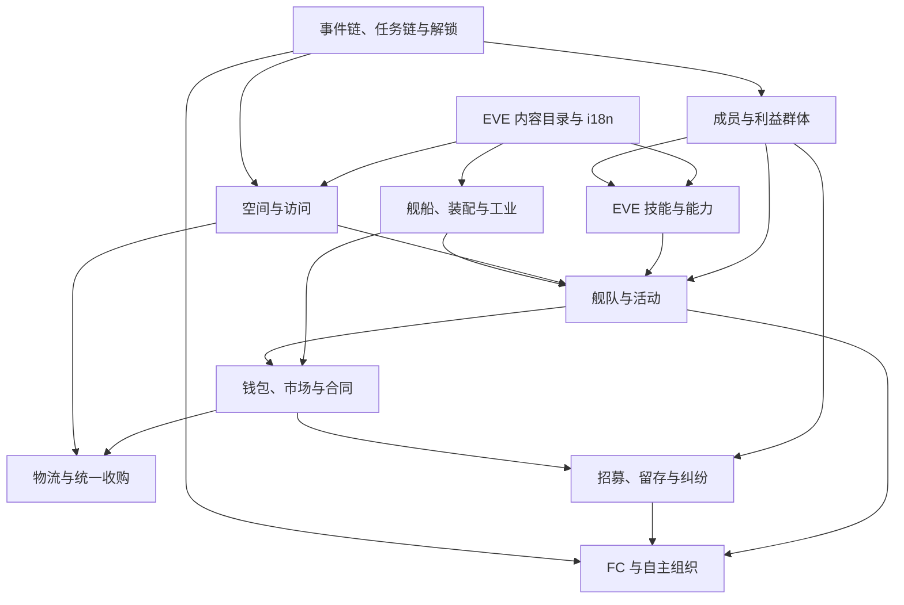

# Alpha 系统模块地图

## 目标体验

MVP 证明了聊天平台上的持久化行动闭环。Alpha 的目标不是堆叠更多命令，而是让玩家感到自己在
经营一个由成员、利益、能力、资产、空间和经济共同构成的 EVE 联盟：一次决策会通过多个系统留下
可解释的长期后果。

## 统一语言

为避免把真实操作者和模拟角色都叫作“玩家”，Alpha 文档采用以下名称：

| 名称 | 含义 |
|---|---|
| Controller | 通过 Discord、Telegram 或未来 Web 操作联盟的真实用户 |
| Alliance | Controller 管理的联盟组织与主要游戏聚合 |
| AllianceMember | 模拟的联盟成员；可以是匿名群体中的成员，也可以被建模为具名个体 |
| MemberCohort | 为性能和策划表达而聚合的一类匿名成员，不等同于 InterestGroup |
| NamedMember | 有稳定身份、经历、关系和能力的特殊联盟成员，例如 FC 或工业骨干 |
| InterestGroup | 围绕偏好和诉求形成的政治/社会组织，可以跨越一个或多个 MemberCohort |
| Role | 联盟授予或成员承担的职责，例如 FC、矿工、护航、物流、工业负责人 |
| EVE Skill | 来自 SDE 的 EVE 技能及等级要求 |
| KnowledgeSkill | 本游戏原创的知识或组织能力，例如配装学、舰队指挥、后勤规划 |
| SkillPlan | 对未来能力目标的有序或有条件计划 |
| Task | 可执行、可重复或一次性的工作定义与运行实例 |
| EventChain | 由触发、选择、延迟和结果构成的叙事/决策图 |
| Unlock | 联盟已经获得的能力、任务、路线、地点或政策权限 |

MemberCohort、NamedMember 与 InterestGroup 是三个不同维度。具名 FC 可以来自某个成员群体并支持
某个利益群体，但不能因为三者有关联就把它们压成同一张“玩家类型”表。

## 模块总览

| 模块 | 负责的问题 | 主要状态 | 典型玩家决策 |
|---|---|---|---|
| EVE 内容目录 | 世界中有哪些类型、地点、技能、蓝图和显示文本 | SDE 投影、内容包、locale 文本 | 选择舰船、模块、星系、产品和技能目标 |
| 叙事与进程 | 如何教学、触发长期事件、开放任务和能力 | EventChain、TaskChain、Unlock、Flag | 接受路线、处理危机、选择联盟发展方向 |
| 成员与利益群体 | 谁在联盟中，他们想要什么，谁拥有影响力 | Cohort、NamedMember、InterestGroup、Demand、Dispute | 回应诉求、调解冲突、任命角色、招募方向 |
| 能力与成长 | 成员计划学什么，实际掌握什么，组织知道什么 | EVE Skill、KnowledgeSkill、SkillPlan、执行事实 | 排定计划、投入教学、调整目标、接受执行偏差 |
| 空间与访问 | 联盟能到哪里，路线如何连接，风险层级是什么 | Region、System、Stargate、RouteAccess、Location | 开放新路线、选择驻地、承担 low/null 风险 |
| 舰队与活动 | 多个成员和舰船如何协作完成活动 | Fleet、Doctrine、Assignment、Operation、FC | 组成矿队与护航、选择活动、授权自动组织 |
| 舰船、装配与资产 | 联盟拥有什么，舰船是否适合任务，损失如何追踪 | Asset、Hull、Fit、Module、CapabilityAssessment | 采用装配、分配舰船、承担短缺或风险 |
| 工业 | 如何把材料和蓝图转化为可用资产 | Blueprint、ProductionOrder、Facility、Capacity | 自产或外购、排产、研究效率、选择产业链 |
| 钱包与市场 | 钱从哪里来、花到哪里、外部价格如何影响选择 | Wallet、LedgerEntry、MarketQuote、Order、Contract | 买卖、定价、预算、签订内部或外部合同 |
| 政策与统一收购 | 联盟如何把重复决策变成可审计政策 | Policy、Proposal、BuybackProgram、Budget | 通过收购决议、分配预算、改变奖励和义务 |
| 物流 | 物资和舰船如何跨星系移动 | Shipment、RoutePlan、HaulerCapacity、ServiceLevel | 选择速度/成本/风险、建立物流服务 |
| 招募与留存 | 成员如何自然加入、主动加入、衰减和离开 | RecruitmentChannel、CandidateFlow、Join/LeaveFact | 宣传、改善条件、接受特定群体增长 |
| 自主组织 | 联盟骨干如何在授权内提出或组织活动 | Authority、Proposal、ScheduledOperation | 设置边界、批准提案、干预失败活动 |

## 依赖关系

图中的依赖表示需要先有可解释的事实，不要求模块成为微服务。Alpha 继续采用模块化单体；跨模块
变化由应用用例和领域事件协调，不能通过任意脚本直接修改其他模块的表。

## 关键系统边界

### EVE 数据与联盟规则

- 类型、技能、蓝图、星系和星门来自固定 SDE build；
- SDE 任务、史诗任务线、地下城和 NPC 数据可作为内容研究来源，不自动变成联盟任务；
- 全局实时物价不在 SDE 中，必须选择 ESI/第三方数据或原创市场模拟；
- 联盟成员行为、风险偏好、满意度和组织效率全部是原创策划层。

### 群体、个体与利益

系统应能记录成员规模变化和具名成员经历，但 Alpha 不应从一开始模拟每个匿名成员的每个属性。
具体聚合维度、具名化条件、利益群体成员重叠和影响力公式属于 GD-001、GD-003。工程模型必须允许
在不重建全部存档的情况下调整粒度。

诉求是可追踪的问题，不只是一个满意度数值。至少要能表达来源、目标、期限、状态和解决结果；
具体权重、升级方式和惩罚由用户策划决定。

### 技能计划与实际执行

技能计划不能只保存最终加成。系统需要分别记录：

- 计划的目标、顺序、条件和预计窗口；
- 成员在该窗口内是否具备训练资格和资源；
- 实际开始、完成、跳过或阻塞的事实及原因；
- 计划版本变化和玩家干预。

“实际执行率”应从这些事实派生，而不是成为可随意改写的源字段。统计窗口、分母、权重和偏离影响
属于 GD-007。EVE Skill 与 KnowledgeSkill 使用不同命名空间，避免把原创能力伪装成 SDE 技能。

### 配装成熟度

装配学不是简单的“等级越高伤害越高”。它可以参与装配合法性提示、适用场景评估、Doctrine
一致性、材料可获得性和执行偏差。具体影响范围由 GD-012 决定；系统应保留评估依据，使玩家能看到
为什么某个装配被认为成熟或不成熟。

### 事件、任务与解锁

EventChain 负责叙事选择，TaskChain 负责编排可执行工作，两者通过显式 Unlock 和领域事件连接：

- 教学章节逐步开放状态、成员、舰队、工业和经济命令；
- 一次性事件可以解锁可重复任务，但不能在查询时偷偷创建任务；
- low/null 开放表现为联盟的 RouteAccess/Capability，不修改 SDE 星门的客观拓扑；
- 新事件效果必须是受控类型，例如资源、钱包、群体状态、任务、路线、角色或政策提案；
- 事件实例继续冻结内容与效果快照，旧按钮在内容升级后仍可解释和幂等处理。

### 舰队协作

Fleet 将多个成员、角色和舰船组成一次 Operation。Doctrine 描述期望角色与装配，Assignment 记录
实际分配。这样“矿船不装自卫武器、由专门舰船护矿”可以表现为整体风险和效率结果，而不是给每艘
矿船硬编码护航加成。

FC 是 NamedMember 承担的 Role；自动组织活动必须受 Authority 限制。系统需要区分“提出活动”
“玩家批准”“自动执行”和“结算”，以支持不同自治程度。

### 钱包、市场、合同和物流

- 联盟钱包使用可审计的复式或等价不可变账本视图，余额不能成为唯一事实；
- 市场报价、订单与最终成交分离，防止价格变化改写旧交易；
- 内部合同必须预留物资或资金，并拥有到期、取消和履约状态；
- 统一收购是 Policy/Program，不是绕过市场的管理员命令；
- 物流移动真实占用时间、路线和运力，失败或取消必须释放预留；
- 产业链依赖 SDE 蓝图事实，但效率、设施、成本和产能使用已确认的联盟规则版本。

## 跨模块事实

建议优先稳定以下领域事实，而不是先设计一张全能状态表：

- `MemberJoined`、`MemberLeft`、`InterestDemandRaised`、`DisputeResolved`；
- `SkillPlanAssigned`、`TrainingBlocked`、`SkillPlanStepCompleted`；
- `TaskUnlocked`、`RouteAccessGranted`、`PolicyAdopted`；
- `FleetProposed`、`FleetLaunched`、`OperationCompleted`；
- `ProductionCompleted`、`ContractFulfilled`、`ShipmentDelivered`；
- `WalletEntryPosted`、`MarketTradeSettled`。

这些名称描述已经发生的事实。是否因此改变满意度、价格或招募率，由版本化规则处理。

## Alpha 之外

Alpha 不承诺完整复刻 EVE Dogma、实时战斗、玩家间主权战争、真实 Tranquility 市场或每个联盟成员的
逐秒模拟。只有当纵向切片证明某项精度能带来新的玩家决策时，才增加对应复杂度。
